# INFORME DE ENTREGA: MOMENTO 2
## DISEÑO, IMPLEMENTACIÓN Y EXPLOTACIÓN DE BASE DE DATOS RELACIONAL

---

### Datos del Proyecto y Entrega Académica

| Campo | Detalle |
| :--- | :--- |
| **Proyecto** | **Atmoscope** — Sistema Global de Monitoreo de Calidad del Aire |
| **Asignatura** | **Gestión de la Información** (Momento 2) |
| **Docente** | **Prof. Laura Melisa Tique Arprilla** |
| **Integrantes** | • **Alejandro Campo Solarte**<br>• **Daniel Amelines Pacheco** |
| **Repositorio GitHub** | [https://github.com/SlayerCampo/BASEDEDATOSCLASE](https://github.com/SlayerCampo/BASEDEDATOSCLASE) |
| **Motor de Base de Datos** | MySQL 8.0.46 Community Server (Motor de almacenamiento: `InnoDB`, Codificación: `utf8mb4_unicode_ci`) |
| **Script SQL Maestro** | [`init/mysql/init.sql`](init/mysql/init.sql) |
| **Carpeta de Evidencias** | [`docs/screenshots/`](docs/screenshots/) |

---

## 1. Modelado Conceptual y Lógico

### 1.1 Modelo Conceptual — Diagrama Entidad-Relación (DER)

El sistema **Atmoscope** centraliza y procesa los registros de calidad del aire provenientes de estaciones meteorológicas y sensores distribuidos a nivel internacional. Modela la estructura geográfica (`Continente` -> `Pais` -> `Estacion`), el catálogo normativo de sustancias nocivas (`Contaminante`), las lecturas cronológicas (`Registro_Calidad`) y la interacción ciudadana a través de suscripciones de alertas (`Usuario` <-> `Usuario_Estacion`).

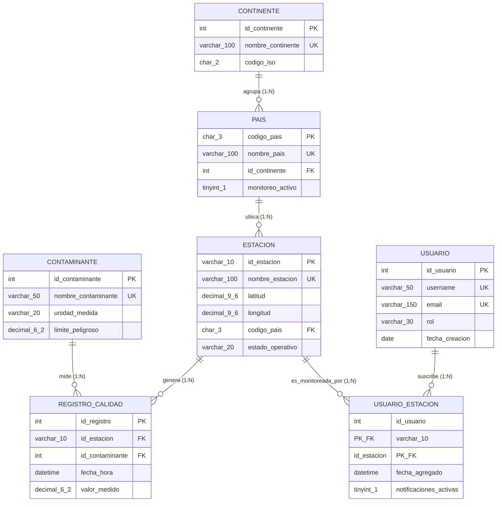

#### Cardinalidades y Semántica de las Relaciones
1. **`Continente` (1) — (N) `Pais`**: Un continente agrupa a 1 o más países; cada país pertenece obligatoriamente a un único continente.
2. **`Pais` (1) — (N) `Estacion`**: Un país alberga una o más estaciones de monitoreo; cada estación pertenece de forma exclusiva a un país.
3. **`Estacion` (1) — (N) `Registro_Calidad`**: Una estación física genera miles de lecturas cronológicas; cada registro proviene de una única estación de origen.
4. **`Contaminante` (1) — (N) `Registro_Calidad`**: Un contaminante (ej. $PM_{2.5}$, $PM_{10}$, $O_3$, etc.) puede ser evaluado en múltiples registros; cada lectura analiza un contaminante puntual.
5. **`Usuario` (N) — (M) `Estacion` (Resuelta mediante `Usuario_Estacion`)**: Un usuario puede guardar como favoritas múltiples estaciones y una estación puede ser monitoreada por múltiples usuarios. La tabla intermedia almacena la clave compuesta `(id_usuario, id_estacion)`, fecha de suscripción y preferencia de notificación.

---

### 1.2 Modelo Lógico Relacional Normalizado

#### Justificación del Proceso de Normalización
- **Primera Forma Normal (1FN):** Todos los valores en cada columna son atómicos e indivisibles (no hay listas separadas por comas ni registros repetitivos); todas las tablas cuentan con clave primaria definida formalmente.
- **Segunda Forma Normal (2FN):** Se cumple 1FN y todos los atributos no clave tienen dependencia funcional completa respecto a la clave primaria. En la relación intermedia `Usuario_Estacion`, tanto `fecha_agregado` como `notificaciones_activas` dependen de la combinación total `(id_usuario, id_estacion)`.
- **Tercera Forma Normal (3FN):** Se cumple 2FN y no existen dependencias transitivas entre columnas no clave. Por ejemplo, los datos del continente no se replican en la tabla `Estacion` ni en `Registro_Calidad`, sino que se derivan a través de la clave foránea a `Pais`.

#### Diccionario Formal de Datos y Restricciones de Integridad

##### 1. Tabla `Continente`
| Columna | Tipo de Dato | Clave | Nulo | Restricciones de Integridad |
| :--- | :--- | :---: | :---: | :--- |
| `id_continente` | `INT` | **PK** | No | `CHECK (id_continente > 0)` |
| `nombre_continente` | `VARCHAR(100)` | **UQ** | No | `UNIQUE (uq_continente_nombre)` |
| `codigo_iso` | `CHAR(2)` | — | No | `DEFAULT 'UN'` |

##### 2. Tabla `Pais`
| Columna | Tipo de Dato | Clave | Nulo | Restricciones de Integridad |
| :--- | :--- | :---: | :---: | :--- |
| `codigo_pais` | `CHAR(3)` | **PK** | No | Código ISO alfa-3 |
| `nombre_pais` | `VARCHAR(100)` | **UQ** | No | `UNIQUE (uq_pais_nombre)` |
| `id_continente` | `INT` | **FK** | No | `REFERENCES Continente(id_continente) ON UPDATE CASCADE ON DELETE RESTRICT` |
| `monitoreo_activo` | `TINYINT(1)` | — | No | `DEFAULT 1`, `CHECK (monitoreo_activo IN (0, 1))` |

##### 3. Tabla `Estacion`
| Columna | Tipo de Dato | Clave | Nulo | Restricciones de Integridad |
| :--- | :--- | :---: | :---: | :--- |
| `id_estacion` | `VARCHAR(10)` | **PK** | No | Identificador alfanumérico único |
| `nombre_estacion` | `VARCHAR(100)` | **UQ** | No | `UNIQUE (uq_estacion_nombre)` |
| `latitud` | `DECIMAL(9,6)` | — | No | `CHECK (latitud BETWEEN -90.000000 AND 90.000000)` |
| `longitud` | `DECIMAL(9,6)` | — | No | `CHECK (longitud BETWEEN -180.000000 AND 180.000000)` |
| `codigo_pais` | `CHAR(3)` | **FK** | No | `REFERENCES Pais(codigo_pais) ON UPDATE CASCADE ON DELETE RESTRICT` |
| `estado_operativo` | `VARCHAR(20)` | — | No | `DEFAULT 'ACTIVA'`, `CHECK (estado_operativo IN ('ACTIVA', 'MANTENIMIENTO', 'INACTIVA'))` |

##### 4. Tabla `Contaminante`
| Columna | Tipo de Dato | Clave | Nulo | Restricciones de Integridad |
| :--- | :--- | :---: | :---: | :--- |
| `id_contaminante` | `INT` | **PK** | No | `CHECK (id_contaminante > 0)` |
| `nombre_contaminante` | `VARCHAR(50)` | **UQ** | No | `UNIQUE (uq_contaminante_nombre)` |
| `unidad_medida` | `VARCHAR(20)` | — | No | `DEFAULT 'ug/m3'` |
| `limite_peligroso` | `DECIMAL(6,2)` | — | No | `CHECK (limite_peligroso > 0)` |

##### 5. Tabla `Registro_Calidad`
| Columna | Tipo de Dato | Clave | Nulo | Restricciones de Integridad |
| :--- | :--- | :---: | :---: | :--- |
| `id_registro` | `INT` | **PK** | No | `AUTO_INCREMENT` |
| `id_estacion` | `VARCHAR(10)` | **FK** | No | `REFERENCES Estacion(id_estacion) ON UPDATE CASCADE ON DELETE RESTRICT` |
| `id_contaminante` | `INT` | **FK** | No | `REFERENCES Contaminante(id_contaminante) ON UPDATE CASCADE ON DELETE RESTRICT` |
| `fecha_hora` | `DATETIME` | — | No | `DEFAULT CURRENT_TIMESTAMP` |
| `valor_medido` | `DECIMAL(6,2)` | — | No | `CHECK (valor_medido >= 0)` |

##### 6. Tabla `Usuario`
| Columna | Tipo de Dato | Clave | Nulo | Restricciones de Integridad |
| :--- | :--- | :---: | :---: | :--- |
| `id_usuario` | `INT` | **PK** | No | `AUTO_INCREMENT` |
| `username` | `VARCHAR(50)` | **UQ** | No | `UNIQUE (uq_usuario_username)` |
| `email` | `VARCHAR(150)` | **UQ** | No | `UNIQUE (uq_usuario_email)`, `CHECK (email LIKE '%_@_%._%')` |
| `rol` | `VARCHAR(30)` | — | No | `DEFAULT 'CIUDADANO'`, `CHECK (rol IN ('ADMIN', 'INVESTIGADOR', 'ANALISTA', 'CIUDADANO'))` |
| `fecha_creacion` | `DATE` | — | No | `DEFAULT (CURRENT_DATE)` |

##### 7. Tabla `Usuario_Estacion`
| Columna | Tipo de Dato | Clave | Nulo | Restricciones de Integridad |
| :--- | :--- | :---: | :---: | :--- |
| `id_usuario` | `INT` | **PK, FK** | No | `REFERENCES Usuario(id_usuario) ON UPDATE CASCADE ON DELETE CASCADE` |
| `id_estacion` | `VARCHAR(10)` | **PK, FK** | No | `REFERENCES Estacion(id_estacion) ON UPDATE CASCADE ON DELETE CASCADE` |
| `fecha_agregado` | `DATETIME` | — | No | `DEFAULT CURRENT_TIMESTAMP` |
| `notificaciones_activas` | `TINYINT(1)` | — | No | `DEFAULT 1`, `CHECK (notificaciones_activas IN (0, 1))` |

---

## 2. Evidencias de Implementación DDL y DML

### 2.1 Conexión al Motor MySQL 8.0.46 y Creación del Esquema `atmoscope_db`
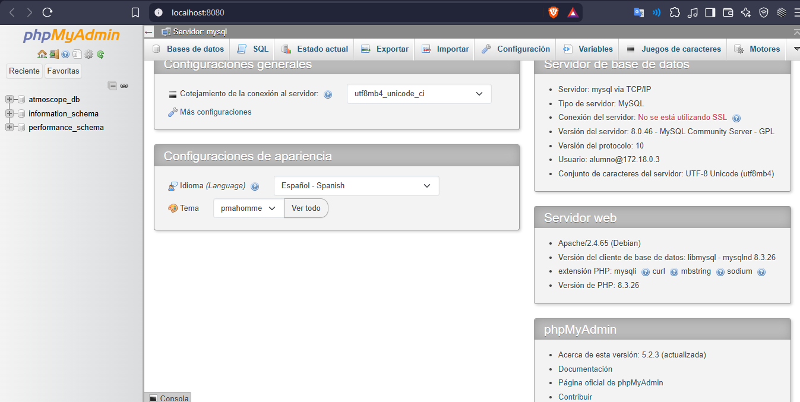

---

### 2.2 Evidencia de Creación de Tablas y Relaciones (DDL — Vista Diseñador)
El script DDL ([`init/mysql/init.sql`](init/mysql/init.sql)) crea exitosamente las 7 tablas con sus claves primarias (`PK`), claves foráneas (`FK`) con integridad referencial y restricciones de columna (`NOT NULL`, `UNIQUE`, `CHECK` y `DEFAULT`).

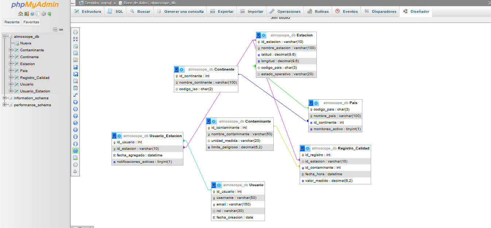

---

### 2.3 Evidencia de Poblado de Datos (DML — `INSERT`)
Se poblaron todas las tablas superando el requisito obligatorio de mínimo 5 registros lógicos por tabla (55 registros en total):

| Tabla | Registros Insertados | Mínimo Requerido | Cumplimiento |
| :--- | :---: | :---: | :---: |
| `Continente` | **5** (`America`, `Asia`, `Europa`, `Africa`, `Oceania`) | 5 | ✅ Cumplido |
| `Pais` | **7** (`COL`, `MEX`, `JPN`, `CHN`, `DEU`, `EGY`, `AUS`) | 5 | ✅ Cumplido |
| `Estacion` | **6** (`COLBOG001`, `COLMED001`, `MEXCDMX01`, `JPTYO001`, `CHNBEI001`, `DEUBER001`) | 5 | ✅ Cumplido |
| `Contaminante` | **5** (`PM2.5`, `PM10`, `O3`, `NO2`, `SO2`) | 5 | ✅ Cumplido |
| `Registro_Calidad` | **20** mediciones horarias multi-estación | 5 | ✅ Cumplido |
| `Usuario` | **6** usuarios (`ADMIN`, `INVESTIGADOR`, `ANALISTA`, `CIUDADANO`) | 5 | ✅ Cumplido |
| `Usuario_Estacion` | **6** suscripciones activas/inactivas | 5 | ✅ Cumplido |

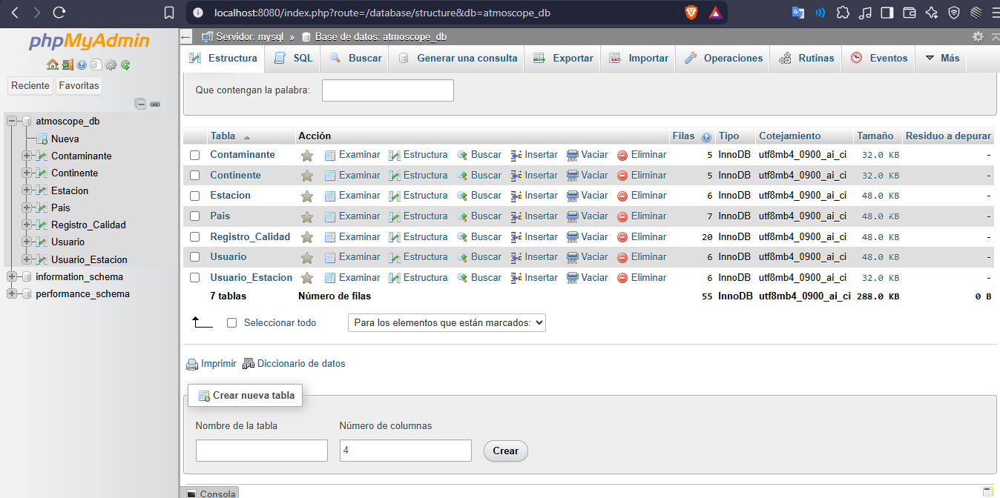

---

## 3. Consultas de Selección (DML — `SELECT`), Justificación de Negocio y Evidencias

### Consulta 1: Filtros Condicionales 1 (`WHERE`, `LIKE`, `BETWEEN`, `AND`, `ORDER BY DESC`)

#### Justificación de Negocio
El equipo de vigilancia epidemiológica de Colombia necesita auditar las mediciones registradas en las estaciones de su país (cuyo código inicia por `'COL'`) durante la jornada crítica del 29 de septiembre de 2026 que presenten concentraciones iguales o superiores a $30.00\text{ }\mu\text{g/m}^3$, ordenadas desde la lectura más alta hasta la más baja para priorizar alertas tempranas en salud pública.

#### Sentencia SQL
```sql
SELECT
    id_registro,
    id_estacion,
    id_contaminante,
    fecha_hora,
    valor_medido
FROM Registro_Calidad
WHERE id_estacion LIKE 'COL%'
  AND fecha_hora BETWEEN '2026-09-29 00:00:00' AND '2026-09-29 23:59:59'
  AND valor_medido >= 30.00
ORDER BY valor_medido DESC;
```

#### Evidencia de Ejecución en el Gestor (Sentencia y Tabla de Resultados)
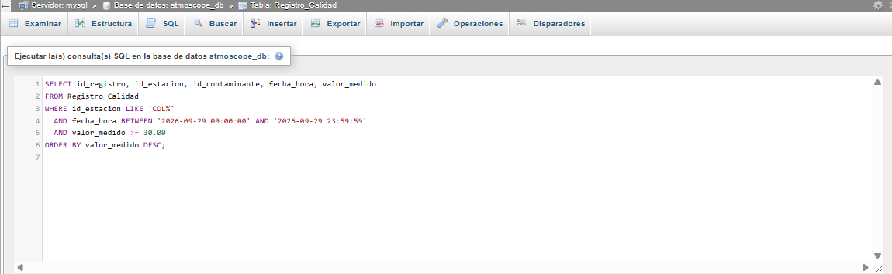

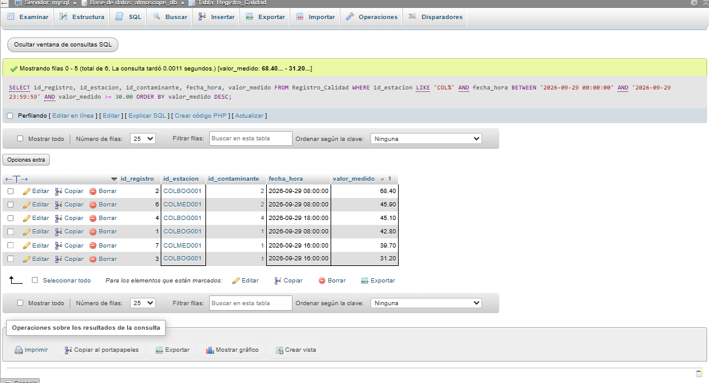

#### Tabla Resumen de Resultados (6 filas devueltas)
| id_registro | id_estacion | id_contaminante | fecha_hora | valor_medido |
| :---: | :---: | :---: | :---: | :---: |
| 2 | COLBOG001 | 2 | 2026-09-29 08:00:00 | 68.40 |
| 6 | COLMED001 | 2 | 2026-09-29 08:00:00 | 45.90 |
| 4 | COLBOG001 | 4 | 2026-09-29 18:00:00 | 45.10 |
| 1 | COLBOG001 | 1 | 2026-09-29 08:00:00 | 42.80 |
| 7 | COLMED001 | 1 | 2026-09-29 16:00:00 | 39.70 |
| 3 | COLBOG001 | 1 | 2026-09-29 16:00:00 | 31.20 |

---

### Consulta 2: Filtros Condicionales 2 (`WHERE`, `IN`, `NOT`, `AND`, `ORDER BY ASC`)

#### Justificación de Negocio
La dirección de operaciones técnicas requiere un listado de las estaciones ubicadas en mercados estratégicos (`COL`, `MEX`, `JPN` y `CHN`) que **no** se encuentren fuera de servicio (`NOT estado_operativo = 'INACTIVA'`) y estén ubicadas en el hemisferio norte (`latitud > 0`), ordenadas alfabéticamente por su nombre de estación para programar la rotación de calibraciones de sensores.

#### Sentencia SQL
```sql
SELECT
    id_estacion,
    nombre_estacion,
    codigo_pais,
    latitud,
    longitud,
    estado_operativo
FROM Estacion
WHERE codigo_pais IN ('COL', 'MEX', 'JPN', 'CHN')
  AND NOT estado_operativo = 'INACTIVA'
  AND latitud > 0
ORDER BY nombre_estacion ASC;
```

#### Evidencia de Ejecución en el Gestor (Sentencia y Tabla de Resultados)
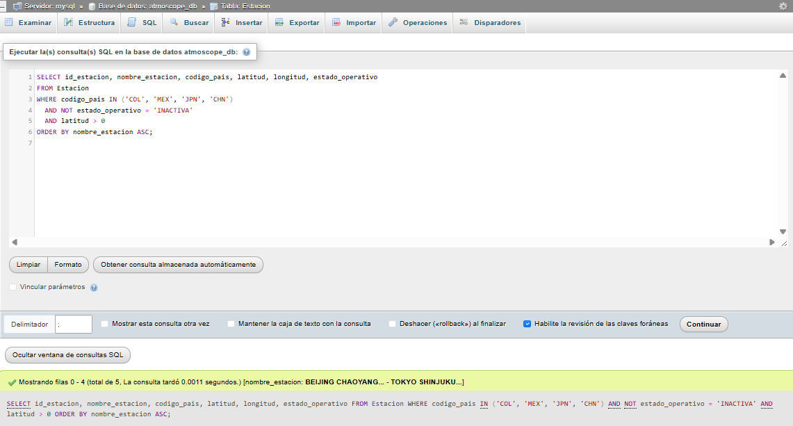

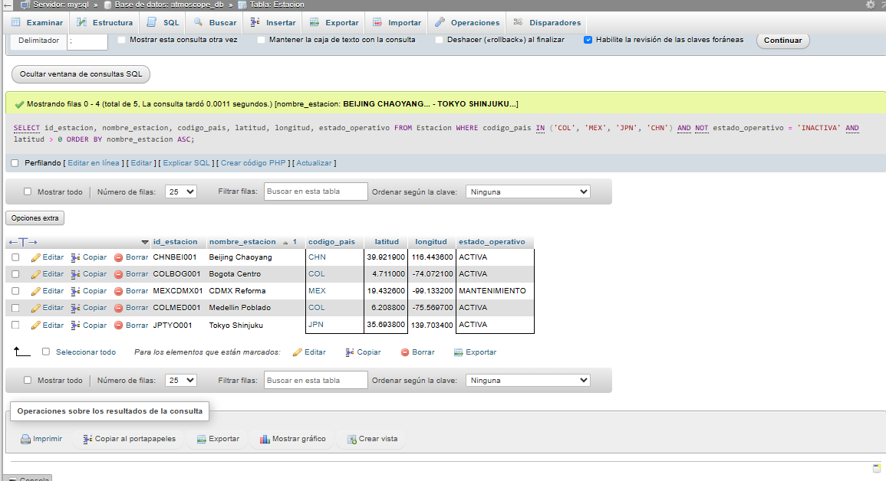

#### Tabla Resumen de Resultados (5 filas devueltas)
| id_estacion | nombre_estacion | codigo_pais | latitud | longitud | estado_operativo |
| :---: | :--- | :---: | :---: | :---: | :---: |
| CHNBEI001 | Beijing Chaoyang | CHN | 39.921900 | 116.443600 | ACTIVA |
| COLBOG001 | Bogota Centro | COL | 4.711000 | -74.072100 | ACTIVA |
| MEXCDMX01 | CDMX Reforma | MEX | 19.432600 | -99.133200 | MANTENIMIENTO |
| COLMED001 | Medellin Poblado | COL | 6.208800 | -75.569700 | ACTIVA |
| JPTYO001 | Tokyo Shinjuku | JPN | 35.693800 | 139.703400 | ACTIVA |

---

### Consulta 3: Combinación de Tablas 1 (`INNER JOIN` entre 5 tablas)

#### Justificación de Negocio
Generar el reporte oficial de **"Excedencias de Límite Peligroso"** para las autoridades ambientales internacionales, cruzando las mediciones con la jerarquía geográfica completa (`Estacion`, `Pais`, `Continente`) y el catálogo de `Contaminante`, mostrando únicamente aquellos eventos críticos donde el `valor_medido` superó el `limite_peligroso` normativo y calculando con precisión matemática la magnitud del exceso sobre la norma.

#### Sentencia SQL
```sql
SELECT
    r.id_registro,
    ct.nombre_continente AS continente,
    p.nombre_pais AS pais,
    e.nombre_estacion AS estacion,
    c.nombre_contaminante AS contaminante,
    r.valor_medido,
    c.limite_peligroso,
    ROUND(r.valor_medido - c.limite_peligroso, 2) AS exceso_sobre_norma,
    r.fecha_hora
FROM Registro_Calidad r
INNER JOIN Estacion e ON r.id_estacion = e.id_estacion
INNER JOIN Pais p ON e.codigo_pais = p.codigo_pais
INNER JOIN Continente ct ON p.id_continente = ct.id_continente
INNER JOIN Contaminante c ON r.id_contaminante = c.id_contaminante
WHERE r.valor_medido > c.limite_peligroso
ORDER BY exceso_sobre_norma DESC;
```

#### Evidencia de Ejecución en el Gestor (Sentencia y Tabla de Resultados)
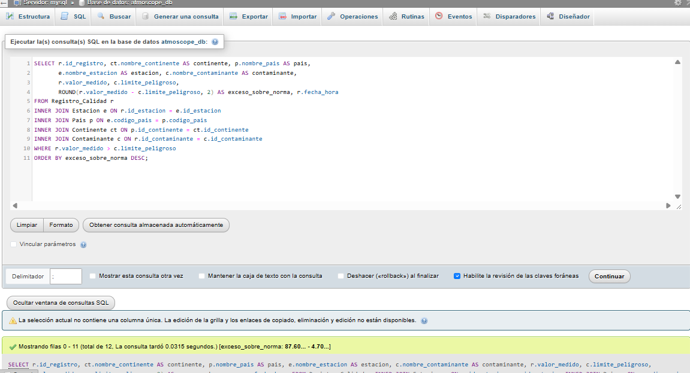

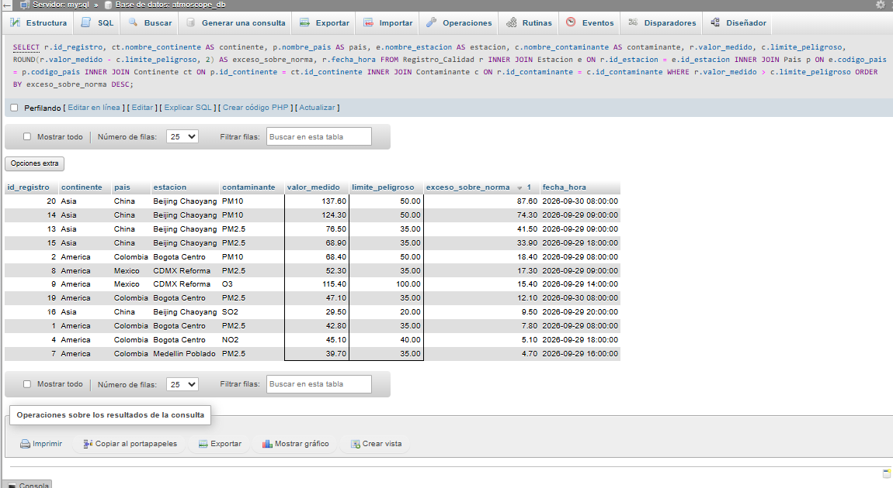

#### Tabla Resumen de Resultados (12 filas devueltas)
| id_registro | continente | pais | estacion | contaminante | valor_medido | limite_peligroso | exceso_sobre_norma | fecha_hora |
| :---: | :---: | :---: | :--- | :---: | :---: | :---: | :---: | :---: |
| 20 | Asia | China | Beijing Chaoyang | PM10 | 137.60 | 50.00 | 87.60 | 2026-09-30 08:00:00 |
| 14 | Asia | China | Beijing Chaoyang | PM10 | 124.30 | 50.00 | 74.30 | 2026-09-29 09:00:00 |
| 13 | Asia | China | Beijing Chaoyang | PM2.5 | 76.50 | 35.00 | 41.50 | 2026-09-29 09:00:00 |
| 15 | Asia | China | Beijing Chaoyang | PM2.5 | 68.90 | 35.00 | 33.90 | 2026-09-29 18:00:00 |
| 2 | America | Colombia | Bogota Centro | PM10 | 68.40 | 50.00 | 18.40 | 2026-09-29 08:00:00 |
| 8 | America | Mexico | CDMX Reforma | PM2.5 | 52.30 | 35.00 | 17.30 | 2026-09-29 09:00:00 |
| 9 | America | Mexico | CDMX Reforma | O3 | 115.40 | 100.00 | 15.40 | 2026-09-29 14:00:00 |
| 19 | America | Colombia | Bogota Centro | PM2.5 | 47.10 | 35.00 | 12.10 | 2026-09-30 08:00:00 |
| 16 | Asia | China | Beijing Chaoyang | SO2 | 29.50 | 20.00 | 9.50 | 2026-09-29 20:00:00 |
| 1 | America | Colombia | Bogota Centro | PM2.5 | 42.80 | 35.00 | 7.80 | 2026-09-29 08:00:00 |
| 4 | America | Colombia | Bogota Centro | NO2 | 45.10 | 40.00 | 5.10 | 2026-09-29 18:00:00 |
| 7 | America | Colombia | Medellin Poblado | PM2.5 | 39.70 | 35.00 | 4.70 | 2026-09-29 16:00:00 |

---

### Consulta 4: Combinación de Tablas 2 (`LEFT JOIN` para auditoría de adopción)

#### Justificación de Negocio
El equipo de experiencia de usuario (UX) necesita auditar a **todos** los usuarios registrados en Atmoscope junto con las estaciones que tienen suscritas, incluyendo explícitamente a aquellos usuarios que aún no han vinculado ninguna estación (mostrados con valores `NULL`), con el propósito de detectar cuentas inactivas y enviarles una campaña de asistencia y activación.

#### Sentencia SQL
```sql
SELECT
    u.id_usuario,
    u.username,
    u.email,
    u.rol,
    ue.id_estacion,
    e.nombre_estacion,
    ue.fecha_agregado
FROM Usuario u
LEFT JOIN Usuario_Estacion ue ON u.id_usuario = ue.id_usuario
LEFT JOIN Estacion e ON ue.id_estacion = e.id_estacion
ORDER BY u.id_usuario ASC;
```

#### Evidencia de Ejecución en el Gestor (Sentencia y Tabla de Resultados)
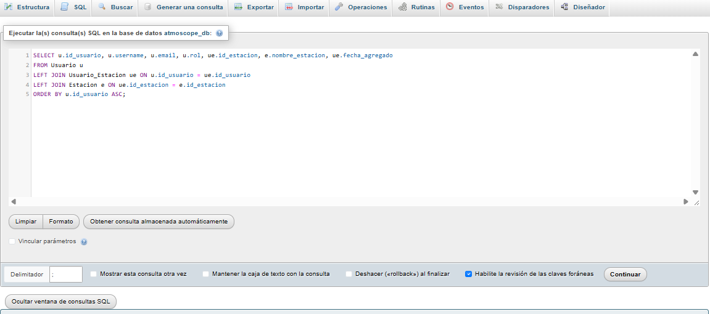

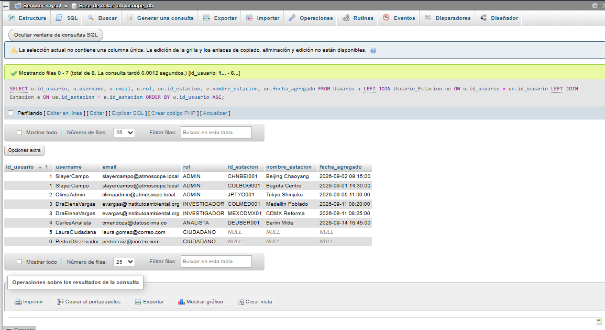

#### Tabla Resumen de Resultados (8 filas devueltas)
| id_usuario | username | email | rol | id_estacion | nombre_estacion | fecha_agregado |
| :---: | :--- | :--- | :---: | :---: | :--- | :---: |
| 1 | SlayerCampo | slayercampo@atmoscope.local | ADMIN | CHNBEI001 | Beijing Chaoyang | 2026-09-02 09:15:00 |
| 1 | SlayerCampo | slayercampo@atmoscope.local | ADMIN | COLBOG001 | Bogota Centro | 2026-09-01 14:30:00 |
| 2 | ClimaAdmin | climaadmin@atmoscope.local | ADMIN | JPTYO001 | Tokyo Shinjuku | 2026-09-05 11:00:00 |
| 3 | DraElenaVargas | evargas@institutoambiental.org | INVESTIGADOR | COLMED001 | Medellin Poblado | 2026-09-11 08:20:00 |
| 3 | DraElenaVargas | evargas@institutoambiental.org | INVESTIGADOR | MEXCDMX01 | CDMX Reforma | 2026-09-11 08:25:00 |
| 4 | CarlosAnalista | cmendoza@datosclima.co | ANALISTA | DEUBER001 | Berlin Mitte | 2026-09-14 16:45:00 |
| 5 | LauraCiudadana | laura.gomez@correo.com | CIUDADANO | `NULL` | `NULL` | `NULL` |
| 6 | PedroObservador | pedro.ruiz@correo.com | CIUDADANO | `NULL` | `NULL` | `NULL` |

---

### Consulta 5: Funciones de Agregación y Agrupamiento (`GROUP BY`, `HAVING`, `COUNT`, `AVG`, `MIN`, `MAX`)

#### Justificación de Negocio
La junta ambiental internacional solicita un resumen estadístico consolidado por estación y contaminante que calcule el total de muestras tomadas (`COUNT`), el promedio de concentración (`AVG`), el valor mínimo (`MIN`) y el pico máximo (`MAX`), filtrando mediante `HAVING` únicamente aquellos grupos cuyo promedio supere los $35.00\text{ }\mu\text{g/m}^3$ para declarar zonas de emergencia sanitaria e intervención prioritaria.

#### Sentencia SQL
```sql
SELECT
    e.id_estacion,
    e.nombre_estacion,
    c.nombre_contaminante,
    COUNT(r.id_registro) AS total_mediciones,
    ROUND(AVG(r.valor_medido), 2) AS promedio_medido,
    MIN(r.valor_medido) AS lectura_minima,
    MAX(r.valor_medido) AS lectura_maxima
FROM Registro_Calidad r
INNER JOIN Estacion e ON r.id_estacion = e.id_estacion
INNER JOIN Contaminante c ON r.id_contaminante = c.id_contaminante
GROUP BY e.id_estacion, e.nombre_estacion, c.nombre_contaminante
HAVING AVG(r.valor_medido) > 35.00
ORDER BY promedio_medido DESC;
```

#### Evidencia de Ejecución en el Gestor (Sentencia y Tabla de Resultados)
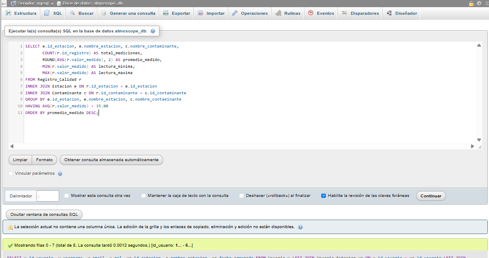

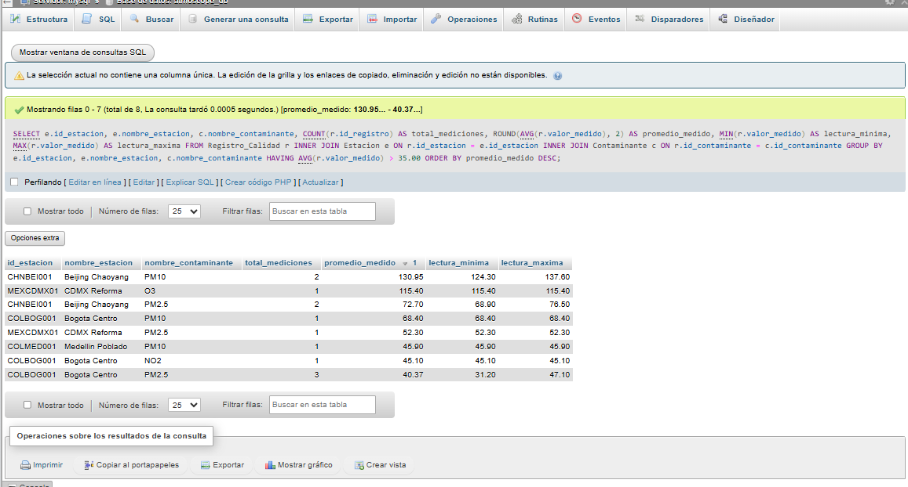

#### Tabla Resumen de Resultados (8 filas devueltas)
| id_estacion | nombre_estacion | nombre_contaminante | total_mediciones | promedio_medido | lectura_minima | lectura_maxima |
| :---: | :--- | :---: | :---: | :---: | :---: | :---: |
| CHNBEI001 | Beijing Chaoyang | PM10 | 2 | 130.95 | 124.30 | 137.60 |
| MEXCDMX01 | CDMX Reforma | O3 | 1 | 115.40 | 115.40 | 115.40 |
| CHNBEI001 | Beijing Chaoyang | PM2.5 | 2 | 72.70 | 68.90 | 76.50 |
| COLBOG001 | Bogota Centro | PM10 | 1 | 68.40 | 68.40 | 68.40 |
| MEXCDMX01 | CDMX Reforma | PM2.5 | 1 | 52.30 | 52.30 | 52.30 |
| COLMED001 | Medellin Poblado | PM10 | 1 | 45.90 | 45.90 | 45.90 |
| COLBOG001 | Bogota Centro | NO2 | 1 | 45.10 | 45.10 | 45.10 |
| COLBOG001 | Bogota Centro | PM2.5 | 3 | 40.37 | 31.20 | 47.10 |
